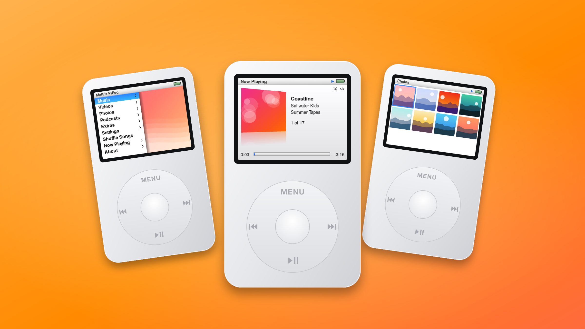
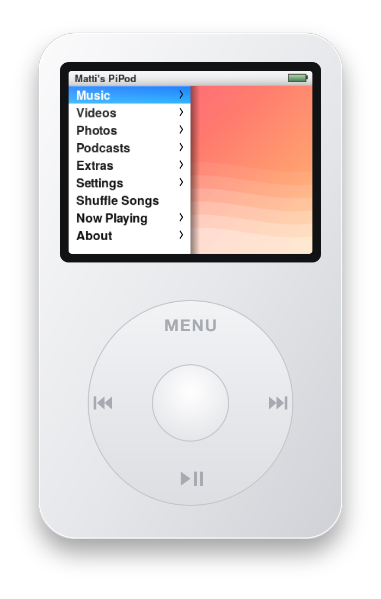
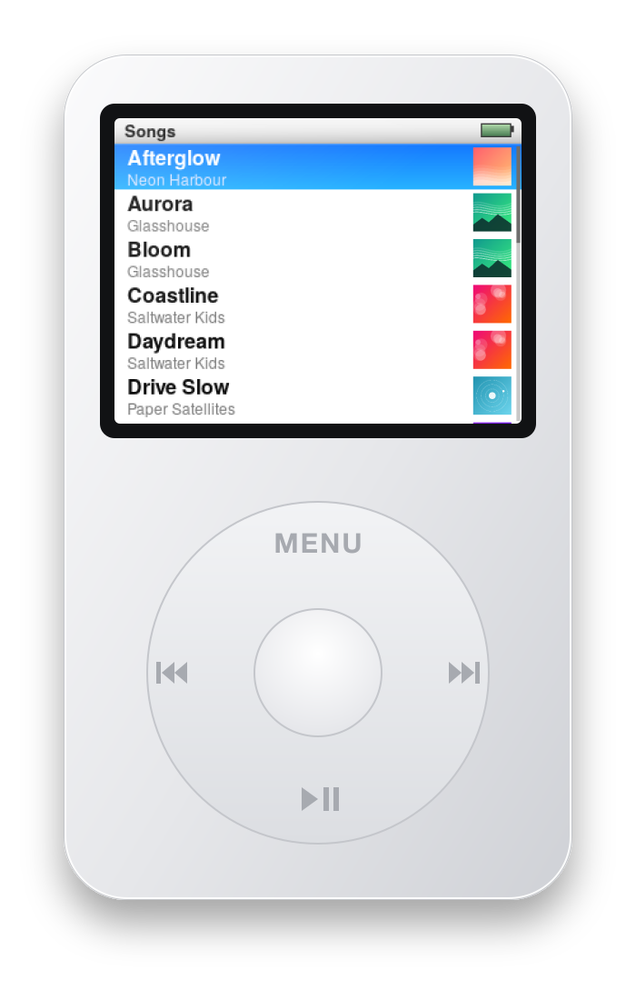
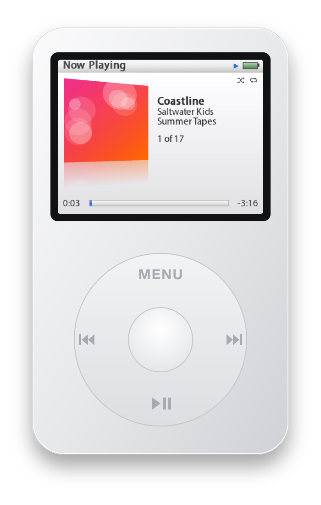
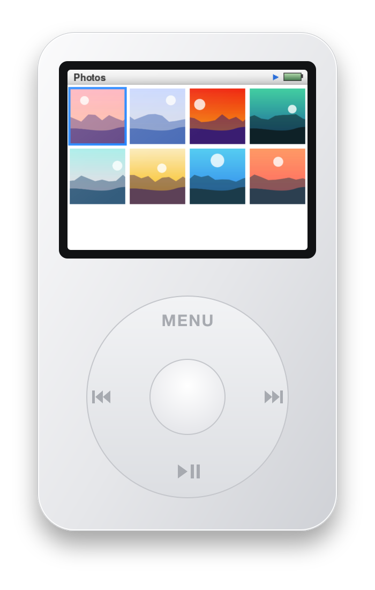
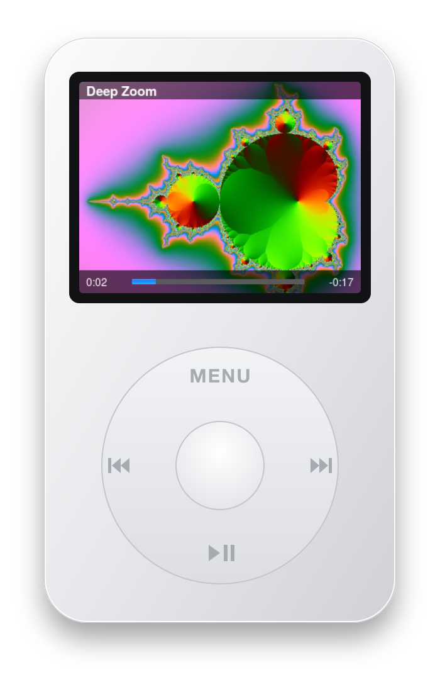
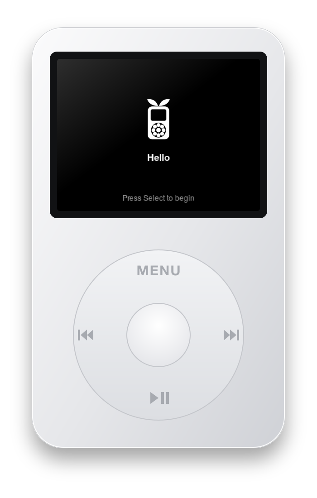
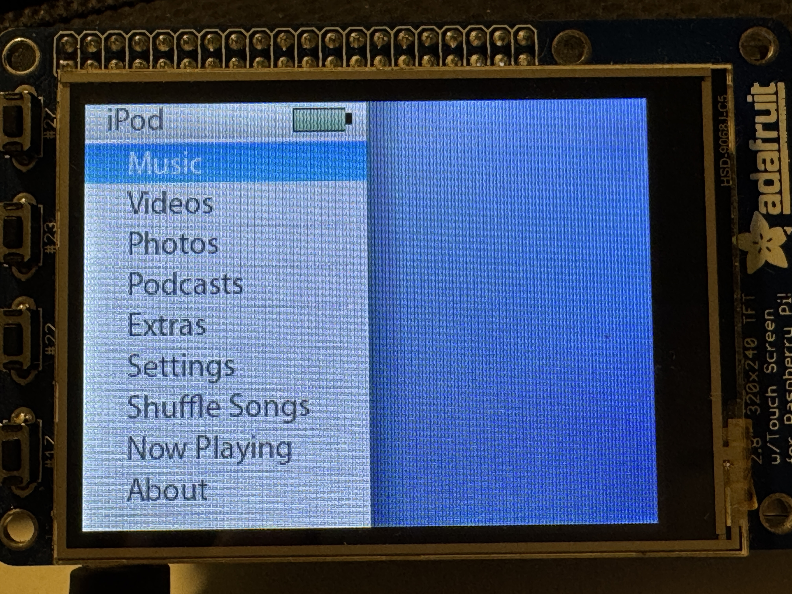
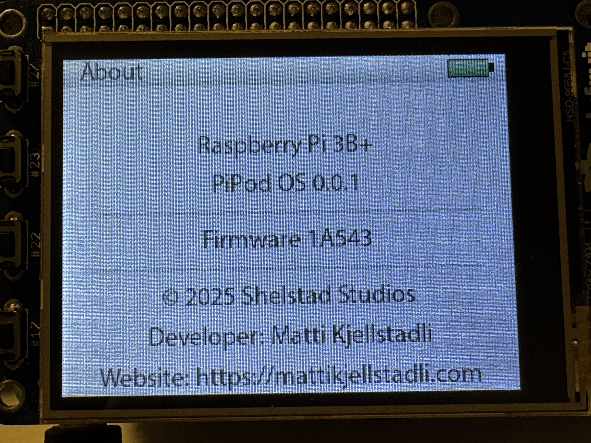
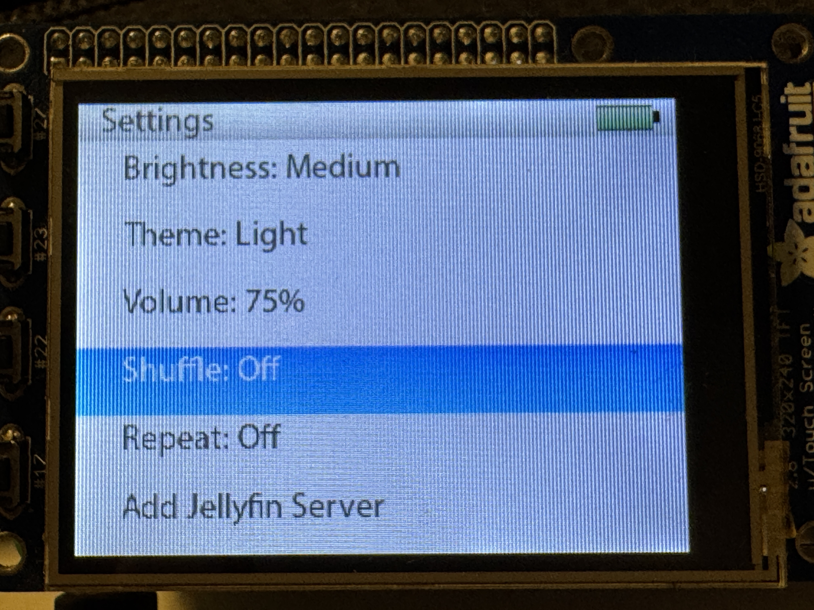

<p align="center">
  
</p>

<h1 align="center">PiPod OS</h1>

<p align="center">
  
</p>

PiPod OS is a recreation of the classic iPod interface and functionality for Raspberry Pi devices.

## Status
**1.0.0 – first release.**
Boots straight into an iPod classic style interface with local and Jellyfin music, first-boot setup,
web upload, videos, photos, podcasts and over-the-air updates. Extras is a placeholder.

## Features

* Complete system image (Raspberry Pi OS Lite) that boots straight into PiPod OS, with a logo boot splash
* iPod classic (6th/7th gen) look: split-screen main menu with album art, Now Playing with tilted
  cover and reflection, About with storage bar
* Music playback (mp3, m4a/aac/alac, flac, wav, aiff, ogg, opus, wma) with play/pause, next/previous, shuffle and repeat
* Optional Jellyfin library: music, plus movies and shows streamed (transcoded to fit the Pi)
* Videos from `~/Videos` (mp4, m4v, mkv, mov, webm, avi) with hardware H.264 decoding on the Pi
* Photos from `~/Pictures`: thumbnail grid, full-screen viewer and slideshow
* Podcasts: subscribe to RSS feeds from the web page; episodes stream into Now Playing
* First-boot Setup Assistant: language, name, password, time zone, Wi-Fi, Jellyfin
* Web page for uploading and deleting music, videos and photos and managing podcasts from a phone
  or computer (Settings → Add Media)
* Over-the-air updates from GitHub releases (Settings → Update), with rollback
* English, Norsk, Svenska, Dansk, Deutsch, Français, Español

## Tech Stack

- **Language:** C++
- **Target OS:** Raspberry Pi OS Lite  
  - While the application should run on most systems, the primary goal is for it to act as an OS frontend. Therefore, Raspberry Pi OS Lite is the main target platform.
- **Libraries / Dependencies:**
  - SDL2 (video, audio, input)
  - SDL2_ttf (font rendering)
  - SDL2_image (image loading)
  - SDL2_mixer (audio playback)
  - TagLib (audio metadata parsing)
  - libcurl + nlohmann/json (Jellyfin API, updates)
  - cpp-httplib (web page), FFmpeg (video playback), tinyxml2 (podcast feeds)
  - TeX Gyre Heros font (free Helvetica clone, GUST Font License; `assets/fonts/`)
  - pi-gen (builds the OS image), Plymouth (boot splash)

## Screenshots

<table>
  <tr>
    <td align="center"><br/>Main menu</td>
    <td align="center"><br/>Songs</td>
    <td align="center"><br/>Now Playing</td>
  </tr>
  <tr>
    <td align="center"><br/>Photos</td>
    <td align="center"><br/>Videos</td>
    <td align="center"><br/>First-boot setup</td>
  </tr>
</table>

Screenshots use generated demo music and photos.

### On real hardware

Test run on Raspberry Pi 3B+, running Raspberry Pi OS 64bit Lite, with a 2.8" PiTFT display.





## Installation

### Flash the image (recommended)

PiPod OS ships as a complete system image: Raspberry Pi OS Lite (Debian trixie, 64-bit) that boots
straight into PiPod OS, with no desktop or login prompt.

1. Download `pipod-os-<version>.img.xz` from the latest release, or build it yourself with
   `os/build-image.sh` (see "How the OS is put together").
2. Flash it with [Raspberry Pi Imager](https://www.raspberrypi.com/software/) ("Use custom").
   Use Imager's OS customisation to set Wi-Fi, a password for the `pipod` user and SSH if you want it.
3. Boot. PiPod OS starts on the screen; plug in a keyboard to control it.

On first boot the **Setup Assistant** runs, iPod style: language, a name for your PiPod (also used
as hostname), a password, time zone, Wi-Fi and optionally Jellyfin. Run it again any time from
Settings → Setup Assistant. Setup is optional when you already configured things in Imager.

Defaults: hostname `pipod`, user `pipod` / password `pipod`, SSH off. Change the password before
turning SSH on. Music goes in `/home/pipod/Music`.

**Display:** the image is set up for the **Waveshare 2.8" DPI LCD** (480x640): its overlays are
included and enabled at the end of `config.txt` on the boot partition. HDMI works too; when you use
only HDMI, comment out the Waveshare lines. For the Adafruit 2.8" PiTFT, comment out the Waveshare
lines and uncomment the `pitft28-resistive` one. The 320x240 interface is scaled up to fit the screen.

The picture is always landscape: on a portrait panel like the Waveshare (480x640) it is turned 90°
automatically and fills the panel at exactly 2×. If it comes out upside down for how your screen is
mounted, use **Settings → Flip Screen**.

### Install on an existing Raspberry Pi OS Lite system

```bash
git clone https://github.com/mattkje/pi-pod-os.git
cd pi-pod-os
scripts/install.sh   # as your normal user; it uses sudo where needed
```

This sets up the same service as the image, running as your user.

## Updates

**Settings → Update** checks GitHub for a newer release, then installs it on a second press and
restarts PiPod OS. Versions live in `/opt/pi-pod-os/releases/<version>` with `/opt/pi-pod-os/current`
pointing at the active one, so a bad update can be undone over SSH with `pipod-update rollback`.

Publishing an update: push a version tag and the `Release` GitHub Actions workflow builds the
arm64 update package and the complete SD-card image (`pipod-os-<version>.img.xz`, about 45 minutes)
and creates the release with both attached.

```bash
git tag v0.2.0 && git push origin v0.2.0
```

## Music

Put audio files in `~/Music` (scanned recursively) or `assets/music`. Artwork is picked up from
`<song>.png/.jpg` next to the file or in an `artwork/` folder, or from `cover.jpg` / `folder.jpg`.

**From another device:** open **Settings → Add Media** on the PiPod. It shows an address such as
`http://pipod.local` (and the IP address) plus a 4-digit access code. Open the address in a browser
on the same network, enter the code, and use the tabs to upload or delete music (`~/Music`),
videos (`~/Videos`) and photos (`~/Pictures`), or to subscribe to podcasts. Changes appear on the
PiPod right away. The code changes every time PiPod OS starts.

To use Jellyfin, open **Settings → Connect Jellyfin** and enter the server URL, username and password.
Only the access token is stored, not the password. Try it with the public demo:
`https://demo.jellyfin.org/stable`, user `demo`, empty password.

## Usage

| Key | Action |
| --- | --- |
| Up / Down | Move selection |
| Enter / Right | Select |
| Backspace / Left | Back |
| Left / Right (Now Playing) | Previous / next song |
| Left / Right (Settings) | Change value |
| Space | Play / pause (also pauses videos and starts/stops the photo slideshow) |
| Left / Right (video) | Jump back / forward 10 seconds |
| Arrow keys (Photos) | Move around the photo grid; Left / Right switch photos in the viewer |
| `+` / `-` | Volume |
| F12 | Save screenshot to `~/.cache/pi-pod-os/screenshots` |
| Esc | Quit when running on a computer (cancels text input in dialogs) |

## How the OS is put together

* `os/build-image.sh` builds the image with [pi-gen](https://github.com/RPi-Distro/pi-gen) (the
  tool that makes Raspberry Pi OS) in Docker: stages 0–2 give Raspberry Pi OS Lite, then
  `os/stage-pipod` compiles the app inside the image, installs it and removes the compilers again.
  Output: `os/deploy/*.img.xz`. `os/build-image.sh --continue` rebuilds only the PiPod stage.
* `pi-pod-os.service` runs the app on tty1 as `pipod`, drawing directly to the display through
  KMS/DRM (no X server), and restarts it if it exits.
* `pipod-system` applies Setup choices as root (hostname, time zone, Wi-Fi country, Wi-Fi via
  NetworkManager, password), validating every argument.
* `pipod-update` installs releases; `/etc/sudoers.d/pi-pod-os` allows Restart / Shut Down from
  Settings.
* `/etc/default/pi-pod-os` holds extra environment for the service.
* Boot splash: a Plymouth theme shows `assets/icons/logo.svg` on black from early boot; the app
  starts on the same logo and fades into the menu. Updates show the logo with a progress bar.
  After changing the SVG, run `scripts/render-logo.sh` to regenerate the PNGs.

Useful over SSH: `journalctl -u pi-pod-os -f` (logs), `sudo systemctl restart pi-pod-os`.

## Translations

UI strings are English in the code and translated through `assets/lang/<code>.json`
(`{"English text": "translation"}`); missing entries fall back to English. To add a language,
add a JSON file and an entry in `I18n::languages()` (`I18n.cpp`).

## Project layout

```
src/
  main.cpp        app start-up, main loop, input
  app/            state, settings, translations, Setup Assistant
  media/          music player, library, video player, photos, podcasts
  net/            Jellyfin client, HTTP helpers, web interface
  system/         OS integration (Wi-Fi, time zone, ...) and device info
  ui/             drawing helpers, menu icons
    pages/        one file per screen
assets/           fonts, icons, translations (lang/), web page (web/)
os/               OS image: pi-gen stage, files installed into the image (rootfs/)
scripts/          build, run, package, install, render-logo
promo/            promo icons
resources/        README images
```

## Development

macOS dependencies:

```bash
brew install cmake pkg-config sdl2 sdl2_ttf sdl2_image sdl2_mixer taglib nlohmann-json cpp-httplib \
  ffmpeg tinyxml2
```

Build and run:

```bash
scripts/run.sh debug     # Debug build in a 320x240 window (the PiTFT resolution)
scripts/run.sh debug --scale 2   # same layout, window twice as big
scripts/run.sh release   # Release build, fullscreen like on the device
```

The app accepts `--windowed`, `--size WxH`, `--scale N` (or `PIPOD_WINDOWED=1`) and `--setup` to
walk through the Setup Assistant (system changes are only simulated when not on the device).
`--display 480x640` opens a window shaped like the Waveshare panel to check the rotated picture, and
`--flip` (or `PIPOD_FLIP=1`) turns it 180°.
IntelliJ run configurations for all three live in `.run/` and show up in the run menu automatically.

Debug builds can replay key presses for quick UI checks, e.g.
`PIPOD_KEYS="down,return,shot,quit" scripts/run.sh debug` (`shot` = screenshot, `wait` = pause).
